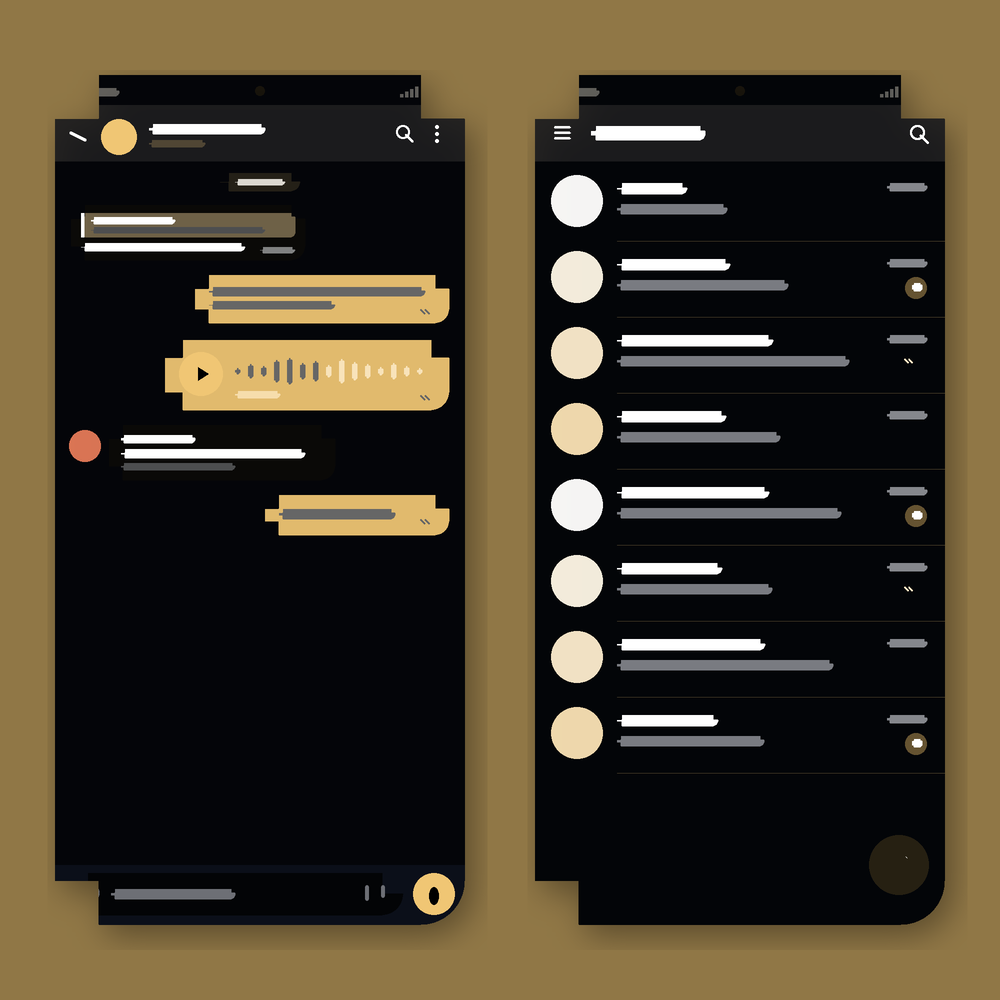
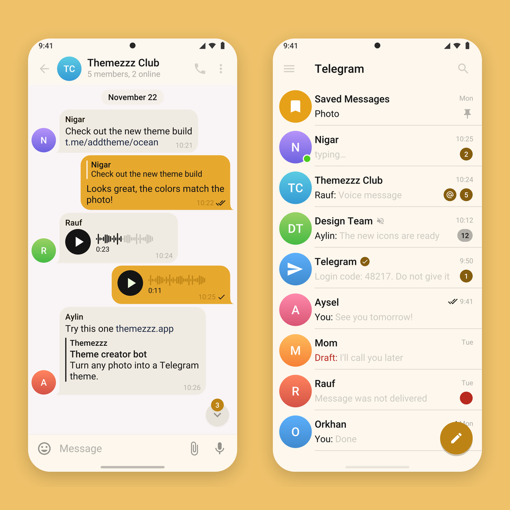

<div align="center">

# 🦀 Themezzz

**Turn any photo into a fully customized Telegram theme — now in Rust.**

*Send an image → get a color palette → tweak every surface → receive a ready-to-apply `.attheme` file.*

[](https://www.rust-lang.org)
[](https://docs.rs/teloxide)
[](#-testing)
[](https://render.com)

</div>

---

## 💡 What is this?

Themezzz is a **Telegram theme-creator bot**. Upload any picture and it
instantly extracts a balanced 6-color palette from it, then lets you paint
every surface of a Telegram theme with those colors — window background,
message bubbles, bars, accents, wallpaper — with live opacity control and
custom `#hex` support. When you're happy, it compiles everything into an
**`.attheme` file** you can apply in Telegram with one tap.

The twist: while you tweak, the bot renders a **real-time dual-phone
preview** (chat view + dialog list view), so you see exactly what the theme
looks like *before* applying it — no more guess-and-retry theming.

This is a full Rust rewrite of the original Python bot: one static binary,
no runtime dependencies, ~10 MB memory footprint, faster image processing.

## ✨ Features

| | |
|---|---|
| 🎨 **Automatic palette extraction** | Median-cut quantization pulls the 6 dominant, visually balanced colors out of any picture |
| 📱 **Real-time dual-phone previews** | Rust-rendered mockups of the Chat View **and** Dialog List View — instant feedback on every tweak |
| 🌗 **Dark & light modes** | Background, text contrast and UI surfaces recalculated instantly per mode |
| 🎛️ **Granular section editing** | `BG` window background · `Bar` top & status bar · `In` incoming bubbles · `Out` outgoing bubbles · `Text` primary text · `Accent` actions, avatars, tabs & FAB · `Reply` quoted text headers · `Wall` wallpaper |
| 🫧 **Opacity sliders** | 0–100% transparency for supported surfaces |
| 🎯 **Custom hex colors** | Type any `#hex` code (e.g. `#34c7a4`) directly in chat |
| ⚡ **Auto mode** | One tap — the bot picks the best palette mapping for you |
| 🖼 **Wallpaper modes** | Use your original image (blurred or not) or a flat color tone |
| ♿ **WCAG-aware contrast** | Text, icons and accents are always readable — no invisible UI |
| 🚀 **24/7 hosting ready** | Built-in axum health-check server + self-ping keep-alive |

## 🖼 Preview

<p align="center">
  
  
</p>

The renderer draws both phones from the same resolved palette the
`.attheme` file uses, so **what you see is what you get**.

## 🦀 Why Rust?

The original Python bot used python-telegram-bot + Pillow + aiohttp. The
Rust port replaces each piece:

| Python | Rust | Notes |
|---|---|---|
| `python-telegram-bot` | [`teloxide`](https://docs.rs/teloxide) 0.13 | Async Telegram bot framework on tokio |
| `Pillow` quantize/blur | [`image`](https://docs.rs/image) 0.25 + custom median-cut | Palette extraction, wallpaper resize/blur |
| `PIL` drawing | custom rasterizer on `RgbaImage` | Rounded rects, circles, arcs, polygons, soft shadows |
| `aiohttp` server | [`axum`](https://docs.rs/axum) 0.7 | `/` health check for Render |
| `aiohttp` self-ping | [`reqwest`](https://docs.rs/reqwest) 0.12 | 9-min keep-alive loop |
| `requirements.txt` | `Cargo.toml` + `Cargo.lock` | Locked, reproducible builds |

Result: a **single static binary**, ~10 MB RAM, milliseconds-fast preview
rendering, and zero interpreter restarts on free hosting tiers.

## 🏗 Architecture

```
src/
├── main.rs        # entrypoint: config → server → keep-alive → polling
├── lib.rs         # library root (colors, preview, state)
├── config.rs      # BOT_TOKEN via dotenvy + env
├── colors.rs      # WCAG math, HLS, palette extraction, .attheme builder
├── preview.rs     # dual-phone Telegram UI renderer
├── state.rs       # sections, labels, per-chat editor state
├── bot.rs         # teloxide handlers + inline keyboard UI
└── server.rs      # axum health check + reqwest keep-alive
```

### Color pipeline

1. **Extract** — the image is thumbnailed to 256 px and median-cut
   quantized to 24 boxes; the most populated boxes that pass a luminance
   filter (0.03–0.97) and are ≥ 45 RGB-distance apart become the palette.
   Fewer than 6 candidates are topped up with lightness variants of the
   most saturated color — hues are never invented.
2. **Resolve** — each section (bg, bar, in/out bubbles, text, accent,
   reply) is either a user pick or an auto derivation
   (`set_lightness` / `clamp_lightness` on palette colors).
3. **Semantics** — link/error/success/flame colors pick the most
   saturated palette color inside each hue range, with fallback to the
   accent; every text color is `ensure_contrast`-checked (WCAG ≥ 3.0).
4. **Serialize** — all 300+ `.attheme` keys are derived from those 7
   colors (bars, gradients, counters, checkboxes, seekbars, …), written
   as `key=argb_int` lines, with an optional wallpaper appended after
   the `WPS` marker.

### Preview renderer

A pure-Rust rasterizer draws the 1000×1000 preview at 2× supersampling:
status bar with signal/wifi/battery glyphs, action bars, date pill,
reply-quote bubbles, voice-note waveform, avatars, unread counters,
FAB, and a Gaussian-blurred drop shadow behind each phone. Wallpaper is
cover-cropped from the original image; everything is clipped to the
phone's rounded frame and Lanczos-downscaled at the end.

## 📖 How it works — the 5-step flow

1. **Send an image** — any photo goes in.
2. **Choose a mode** — Dark 🌙 or Light ☀️.
3. **Pick a section** — `BG`, `Bar`, `In`, `Out`, `Text`, `Accent`, `Reply` or `Wall`.
4. **Apply a color** — palette number 1–6, ⚡ Auto, a custom `#hex`, or a 🫧 transparency tweak.
5. **Create the theme** — ✅ and the compiled `.attheme` file lands in your chat, ready to apply.

## 🚀 Getting started

```bash
# 1. get the code
git clone https://github.com/Abdullayews/Themezzz.git
cd Themezzz

# 2. configure
cp .env.example .env        # then put your bot token into .env

# 3. build & run
cargo run --release
```

Get a bot token from [@BotFather](https://t.me/BotFather).

### Environment variables

| var | required | meaning |
|---|---|---|
| `BOT_TOKEN` | ✅ | Telegram bot token from @BotFather |
| `PORT` | — | health-check server port (default 8080, Render sets it) |
| `RENDER_EXTERNAL_URL` | — | enables the self-ping keep-alive on Render |
| `RUST_LOG` | — | log filter (default `info`) |

## ☁️ Deploy on Render

The repo ships a `render.yaml` blueprint:

1. Push to GitHub.
2. In Render: **New → Blueprint**, pick this repo.
3. Set the `BOT_TOKEN` env var when prompted.
4. Done — the service builds with `cargo build --release --locked`,
   starts `./target/release/themezzz`, and pings itself every 9 minutes
   so the free tier never sleeps.

## 🧪 Testing

```bash
cargo test                        # 7 unit tests: color math, palette, theme
                                  # resolution, attheme serialization,
                                  # wallpaper embedding
cargo run --bin render_preview    # regenerate assets/preview_*.png
cargo run --bin make_theme        # offline .attheme smoke test (stdout
                                  # or: -- out.attheme writes the file)
```

`render_preview` doubles as the visual regression tool — run it after
touching `preview.rs` and eyeball the two PNGs. `make_theme` replaces the
old Python `smoke_test.py`: it resolves a built-in palette and dumps a
517-key `.attheme` without touching Telegram.

## 🗺 Roadmap

- [ ] Inline theme gallery (top community themes)
- [ ] Direct `.attheme` preview inside the chat preview
- [ ] Multi-image palette blending

## 📄 License

MIT — do whatever, credit appreciated.
